# ĐẶC TẢ KIẾN TRÚC KỸ THUẬT HỆ THỐNG AI CLAW (ARCHITECTURE SPEC)
**Dự Án**: AI Claw — Smart Multi-AI Desktop Automation Platform  
**Phiên Bản**: `v2.5.0`  
**Ngày Cập Nhật**: `2026-10-12`  
**Môi Trường**: Windows 10/11 x64 | Python 3.12+ | PyQt6 | SQLite3 | Google GenAI SDK | Multi-Provider AI

---

## 1. Sơ Đồ Kiến Trúc Hệ Thống (System Architecture Diagram)

```mermaid
graph TD
    subgraph UI_Layer [Tầng Giao Diện Người Dùng - PyQt6]
        MainWindow[MainWindow - Sidebar & Stacked Panels]
        ChatPanel[ChatPanel - Multi-AI Streaming & Vision]
        AutomationPanel[AutomationPanel - Visual Workflow & Tasks]
        ImagePanel[ImagePanel - AI Image Studio]
        KnowledgePanel[KnowledgePanel - RAG Knowledge Management]
        LogViewer[LogViewer - Live Diagnostic Stream]
        SettingsDialog[SettingsDialog - 5 Tabs Config & Model Matrix]
        FloatingWidget[FloatingWidget - Mini Quick Access Dock]
        LoginDialog[LoginDialog - Secure PBKDF2 Auth]
        ToastManager[ToastNotification - Multi-Position Alerts]
    end

    subgraph Core_Engine_Layer [Tầng Điều Phối Lõi - Core Engine]
        ChatWorker[ChatWorker - Asynchronous QThread]
        ModelTestWorker[ModelTestWorker - Latency & Health Check]
        ScreenAnalyzer[ScreenAnalyzer - MSS + WebP Pipeline]
        ActionExecutor[ActionExecutor - Mouse/Keyboard Safe Execution]
        KnowledgeBase[KnowledgeBase - RAG Vector/Text Retrieval]
        ImageGenerator[ImageGenerator - Imagen & SD Pipeline]
    end

    subgraph Service_Registry_Layer [Tầng Dịch Vụ AI & Đăng Ký Mô Hình]
        ModelRegistry[ModelRegistry - 79 Models / 16 Providers]
        AIEngine[GeminiAIEngine - Multi-Provider Dispatcher]
        KeyManager[KeyManager - SQLite Pool & Health Rotation]
        SmartResolver[Smart Model Resolver & 404 Auto-Fallback]
    end

    subgraph Persistence_Layer [Tầng Lưu Trữ & Trạng Thái - SQLite & Config]
        StateManager[StateManager - Thread-safe SQLite app_data.db]
        ConfigStorage[YAML / JSON Presets & Workflows]
        ErrorLogger[Global Crash Handler & error_log.txt]
    end

    MainWindow -->|Event Dispatch| ChatWorker
    MainWindow -->|Quick Floating Trigger| FloatingWidget
    MainWindow -->|Security Gate| LoginDialog
    MainWindow -->|Alert Event| ToastManager

    ChatPanel -->|User Prompt & Image| ChatWorker
    ChatWorker -->|Generate Content| AIEngine
    AIEngine -->|Model Query| ModelRegistry
    AIEngine -->|Active Key| KeyManager
    AIEngine -->|404 Handshake| SmartResolver

    AutomationPanel -->|Execute Step| ActionExecutor
    AutomationPanel -->|Capture Context| ScreenAnalyzer
    KnowledgePanel -->|Query Chunks| KnowledgeBase

    StateManager -->|Persist Chats, Users, Settings| Persistence_Layer
    KeyManager -->|Load & Mask API Keys| Persistence_Layer
```

---

## 2. Ma Trận Tính Năng Toàn Diện (Feature Matrix)

| Mã ID | Tên Tính Năng | Phân Loại | Đường Dẫn Mã Nguồn | Layout Impacts | Trạng Thái |
| :--- | :--- | :--- | :--- | :--- | :--- |
| `FEAT-001` | Multi-AI Engine 79 Models / 16 Providers | Code Lõi | `core/ai_engine.py`, `core/model_registry.py` | `chat_panel`, `settings_dialog` | Hoàn thành |
| `FEAT-002` | Desktop Automation & Visual Workflow | Tự Động Hoá | `core/action_executor.py`, `ui/automation_panel.py` | `automation_panel`, `workflow_tree` | Hoàn thành |
| `FEAT-003` | Screen Analyzer MSS & WebP High Performance | Xử Lý Ảnh | `core/screen_analyzer.py` | `chat_panel`, `screenshot_btn` | Hoàn thành |
| `FEAT-004` | Key Manager & SQLite API Rotation Pool | Bảo Mật | `core/key_manager.py` | `settings_dialog_tab2`, `key_table` | Hoàn thành |
| `FEAT-005` | Floating Quick Access Mini Widget | Giao Diện | `ui/floating_widget.py` | `floating_dock`, `always_on_top` | Hoàn thành |
| `FEAT-006` | Auth & User Management PBKDF2 Encryption | Bảo Mật | `ui/login_dialog.py`, `core/state_manager.py` | `login_modal`, `settings_user_tab`| Hoàn thành |
| `FEAT-007` | Dual Theme Dark/Light & 4 UI Densities | Giao Diện | `ui/theme.py`, `ui/main_window.py` | `theme_engine`, `density_scale` | Hoàn thành |
| `FEAT-008` | Customizable 6-Position Toast Notification | Giao Diện | `ui/toast.py` | `toast_overlay`, `smart_queue` | Hoàn thành |
| `FEAT-009` | RAG Knowledge Base & Document Indexing | AI & Dữ Liệu | `core/knowledge_base.py`, `ui/knowledge_panel.py`| `knowledge_panel`, `doc_list` | Hoàn thành |
| `FEAT-010` | AI Image Studio Generation & Variations | AI Đồ Hoạ | `core/image_generator.py`, `ui/image_panel.py` | `image_panel`, `gallery_view` | Hoàn thành |

---

## 3. Danh Mục Sửa Lỗi & Ổn Định (Bug Fixes & Lessons Learned)

| Mã Fix | Tên Sự Cố Đã Xử Lý | Phân Loại | File Liên Quan | Trạng Thái |
| :--- | :--- | :--- | :--- | :--- |
| `FIX-001` | Khắc Phục Treo UI (Not Responding) Khi Mở Settings | Đa Luồng / UI | `ui/settings_dialog.py` | Đã giải quyết |
| `FIX-002` | Khắc Phục Lỗi 404 NOT_FOUND Google GenAI Model | AI API | `core/ai_engine.py` | Đã giải quyết |
| `FIX-003` | Sửa Lỗi SQLite Table Migration `api_keys` | CSDL | `core/key_manager.py` | Đã giải quyết |
| `FIX-004` | Xử Lý NameError Thiếu Import Qt Widgets | Khởi Tạo UI | `ui/main_window.py`, `ui/knowledge_panel.py` | Đã giải quyết |
| `FIX-005` | Xử Lý Lỗi Thread Safety Trong Chat Worker Stream | Đa Luồng | `core/ai_engine.py`, `ui/chat_panel.py` | Đã giải quyết |
| `FIX-006` | Tối Ưu Bảng Màu Tương Phản Chuẩn WCAG Light Mode | Giao Diện | `ui/theme.py` | Đã giải quyết |
| `FIX-007` | Cơ Chế ScrollArea Tự Động Co Giãn Thông Minh | Giao Diện | `ui/settings_dialog.py` | Đã giải quyết |
| `FIX-008` | Dọn Dẹp Rác Build 317MB & Cấu Hình Gitignore Chuẩn | Hệ Thống | `.gitignore`, `build/`, `dist/` | Đã giải quyết |
